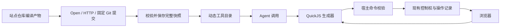

# 网站运行包 API 2：通用宿主与恢复协议

这是迁移基础设施的开发协议。现有学习通、在浙学仍使用旧工具；本协议尚未承接它们的完整业务，也尚未部署到 Open。

## 分发与注册

网站包的 `website.json`、`SKILL.md`、`site-graph.json`、图标和可选的 `runtime.json` 从同一 Git 提交读取。`runtime.json` 包含编译好的 IIFE JavaScript、SHA-256 和工具描述，不加载 TypeScript 源码。构建在站点仓库完成，客户端只验证和运行产物。

HTTP 快照在原有字段之外增加 `runtime`，内容就是 `runtime.json`。文档、图标、工具和产物作为一个快照验证、保存和替换。文件校验失败时保留旧快照。编译产物不放入经验正文，也不发送给模型。

工具名由宿主生成：`browser_site_<网站 id>__<包内工具名>`。网站 id 中的 `-` 转为 `_`；网站 id 不允许 `_`。包内工具名满足 `[a-z][a-z0-9_]{0,23}`。此格式与已有 `browser_site_graph` 区分。安装未知网站包不需要改客户端工具名单。



```json
{
  "apiVersion": 2,
  "bundle": {
    "code": "var ZErrorSitePackage = { *create({tool,args}) { const page = yield {op:'browser.observe',args:{}}; return {title:page.title}; } };",
    "sha256": "由构建脚本计算 code 的 UTF-8 SHA-256，填入 64 位小写十六进制"
  },
  "tools": [{
    "name": "read_catalog",
    "description": "读取本站课程",
    "parameters": {"type":"object","properties":{},"required":[],"additionalProperties":false},
    "result": {"type":"object","properties":{"title":{"type":"string"}},"required":["title"],"additionalProperties":false},
    "commands": ["browser.observe"]
  }]
}
```

示例中的哈希占位文字必须替换后才是可安装产物。源码导出同步生成器 `create({tool,args})`，由站点构建器打包成全局 `ZErrorSitePackage`。每次 `yield` 发送一个命令，下一次 `.next()` 接收该命令的宿主回执。最终 `return` 必须符合声明的结果 schema。该生成器只在当前调用期间存活，不可当作跨进程检查点。

工具参数和结果 schema 使用宿主确实实施的有限 JSON Schema 字段：`type`、`description`、`properties`、`required`、`additionalProperties`、`items`、`enum`、`minimum`、`maximum`、`minItems`、`maxItems`。对象必须禁止额外字段；数组必须声明最多 1024 项的上限；输入与结果的根类型必须是对象。不支持 `$ref`、任意联合类型和可执行校验器。

## 已实现的宿主命令

| 命令 | 参数 | 宿主路径 |
| --- | --- | --- |
| `browser.observe` | `{}` | `browser_get_page` |
| `browser.navigate` | `{url}` | `browser_navigate` |
| `browser.click` | `{ref}` | `browser_click` |
| `browser.fill` | `{ref,text}` | `browser_type`，只支持普通文本 |
| `browser.press` | `{key}` | `browser_press`，按键采用协议枚举 |
| `browser.scroll` | `{amount}` | `browser_scroll`，整数 -10000 至 10000 |
| `browser.wait` | `{ms}` | 可取消的延迟，最多 30 秒 |
| `page.wait` | `{timeoutMs}` | 只等待当前标签后续的页面加载结束事件，最多 30 秒 |

`page.wait` 不追溯已结束的加载，也不表示视频或业务任务完成。实际事件订阅由宿主实现，包不能选择原生 IPC 事件名。

包必须在工具描述中声明将使用的命令，宿主对每一条实际命令再次校验。命令通过既有工具入口执行，保留浏览器控制权、权限模式、操作记录与观察回执。包不能获得整个宿主函数表、IPC、文件系统、`window`、`process` 或 `fetch`。真实密码只在原生凭据边界解析。任意页面脚本和任意跨域 HTTP 不在此命令集内。应用账号服务、题库和模型通过下述受控通用能力调用。

新协议还提供以下命令，全部按声明的命令集校验：

| 命令 | 主要参数 | 行为 |
| --- | --- | --- |
| `document.list` | `{}` | 列出授权域内的文档，返回 `frameId`、`loaderId`、`url`；不返回外站子页面内容 |
| `document.query` | `document, selector, limit` | 固定的有界 DOM 查询，不接受页面 JS，不返回输入框 value |
| `document.click` / `document.fill` | `document, selector, nth?, text?` | 操作确切文档中的唯一元素；普通填写拒绝密码框和受保护账号框 |
| `credentials.request` | `document, replaceRejected?` | 显示聊天安全表单或复用已保存凭据，脚本只获得临时 `credential_id` |
| `credentials.fill` | `document, selector, nth?, credential_id, field` | `field` 为 account/password；宿主转为原生安全填写，密码不进入脚本或模型 |
| `media.read` / `media.play` / `media.pause` | `document, selector, nth?` | 读取或控制指定 HTML video/audio 元素 |
| `media.mute` | `document, selector, nth?, muted` | 设置该媒体元素的静音状态 |
| `media.wait` | `document, selector, nth?, until, timeoutMs` | 监听 ended/playing/paused，单次最多 30 秒，不发起模型请求 |
| `workflow.checkpoint` | `{state}` | 保存可序列化的语义阶段，最多 8 KiB，不保存生成器调用栈 |

`document` 必须完整包含宿主返回的 `{frameId,loaderId,url}`。每次读取和操作都重新核对它，网址相同但加载标识不同也视为新文档。新接口的 CSS 选择器和业务判断来自仓库；客户端只保留固定 DOM 操作、域名边界、凭据隔离及权限和回执记录。输入框的 `value`、任意属性名、HTML、任意页面函数都不在查询接口中。

当前允许网站主域及其子域的 HTTPS 页面，不允许端口、URL 用户信息或其他域。普通 `browser.*` 命令仍拒绝含子 frame 的页面，防止借通用快照或旧 ref 跨页面操作；iframe 内容使用绑定文档身份的 `document.*` 命令。原生层只接受当前浏览器实际 frame 树中的目标，不凭包传来的 URL 授权。

平台能力有差异：CEF 使用原生 frame/loader 身份并支持子页面安全填写；WebView2 使用 CDP 文档身份，安全填写当前只支持主文档；Linux/WebKitGTK 使用绑定当前主文档的固定操作，尚不开放子 frame 或安全密码填写。子页面安全填写不支持时会在显示表单前明确返回。浏览器可达性和原生引擎能力不能由软件包自行声明。

媒体等待在原生文档中注册有限期事件监听，结束、错误或超时后释放；取消时尝试清理同一等待标识，导航会销毁旧文档。已发出的原生请求不能假定已被取消，兜底等待有 30 秒期限。等待媒体或用户安全表单时暂停工具的活动时间预算，避免正常播放或输入导致两分钟超时。

限制包括：产物 256 KiB、`runtime.json` 512 KiB、最多 32 个工具、描述合计 64 KiB、参数与单次回执 128 KiB、每次调用最多 512 条命令且总时间最多 120 秒、首次初始化最多约 500 ms、之后每段同步执行最多约 100 ms、沙箱内存 8 MiB。宿主原有任务预算同时生效。

## 执行、更新与清理

调用开始时固定包版本、哈希、工具描述和安装授权标识。正常更新用于新调用，既有调用继续使用固定版本；删除工具、卸载或切换来源会撤销旧授权。卸载后重新安装相同来源也会生成新授权。

执行实例使用自己的取消信号，关联父任务、浏览器选择、标签关闭及仓库变更。实例结束后释放监听和观察；页面事件订阅、延迟定时器在取消时清理。已经发给浏览器的操作不能假定已撤销，仍由原有不确定操作核对流程处理。运行失败后不会自动换版本从头重放。

宿主返回 `{ok,observed,repository:{id,revision,sha256},result}`。包内结果在 `result` 下，不可伪造宿主外层的观察编号。`observed` 根据实际页面读取设置，网页操作会清除先前观察；宿主运行控制器据此记录当前标签的观察证据。包执行成功表示该工具调用结束；整体目标是否完成仍由 Agent 结合宿主证据决定。

### 持久检查点

`workflow.checkpoint` 将当前包、原始参数和语义状态保存在系统密钥保护的 `website_workflows` 文档中。每条状态最多 8 KiB、输入最多 32 KiB，最多保留 16 条，整个文档最多 2 MiB。写入失败会阻止继续执行；不静默丢弃旧检查点。浏览器预览使用现有会话内安全存储语义，不提供跨进程持久化承诺。

包通过 `create({tool,args,resume})` 恢复。`resume` 包含 `state` 和 `checkpoint_id`；宿主重新创建生成器，旧 JS 栈、定时器、DOM 引用和凭据授权都不会恢复。仓库应保存课程/章节标识和阶段，在恢复入口重新定位、读取并判断真实状态，不能保存旧 ref 当作未来操作目标。

恢复固定原包字节与哈希、原浏览器和输入范围，且安装来源必须仍获授权。当前工具被移除、来源改变或目标浏览器不同会拒绝恢复。恢复后必须先读取实际页面；直接点击、填写、覆盖检查点或直接声明完成都会被拦截。原有不确定操作仍需宿主核对，读一遍页面不等于自动确认旧提交完成。

当前对话通过通用工具 `browser_workflows` 的 list/resume/discard 管理检查点。新轮次只注入检查点标识，由模型结合用户目标决定是否恢复；存在检查点时跳过旧的快捷启动路径，避免先执行一遍平台登录。正常执行成功后删除检查点；中断保留，卸载仓库或删除对话时清理。每个浏览器标签同时只允许一个包流程实例，包含父会话与子任务。

凭据授权仅属于当前实例和确切文档，每个字段最多发出一次填写；文档更换、取消、卸载或实例结束即失效。恢复后需要重新取得临时授权，不能靠持久化引用继续填密。

这些接口已经接入正式调用路径并有契约测试。受控服务、本地题库、模型回退和页面自动任务已实现，在浙学的旧登录、播放、答题及解析上传入口已移除。学习通仍有旧业务路径待清理，三端真实网页回归也不能用本机单元测试代替。迁移尚未全部完成。

## Open 分发

继续使用现有 `/v1/website-experience/<host>` 和自定义 `experience.json` 地址，不新增 `/v2` 路径或版本选择参数。仓库仅发布一份 `runtime.json`，包内 `apiVersion:2` 用于格式校验。Open 校验同提交的 Git blob 和产物 SHA-256 后缓存完整快照；ETag 和 `revision` 对应该快照的提交。构建及文档不保留旧版脚本、旧版清单或回退流程。接口补丁尚未部署。

## 验证入口

`testdata/agent/website-runtime*.test.ts`、`website-repository-registry.test.ts` 和 `website-repository-github.test.ts` 覆盖编译包、动态工具、真实 HTTP 安装、宿主分发、操作记录、版本固定、撤权、损坏缓存和资源清理。`.github/workflows/site-runtime-checks.yml` 配置 macOS、Windows、Linux 的协议测试；这是宿主协议测试，不代替三端原生浏览器实测。

`docs/site-migration-inventory.json` 与 `scripts/site-boundary-audit.mjs` 建立现存平台代码预算。CI 拒绝新增识别到的平台入口或扩大平台专用文件。它是迁移期间的防回退检查，不能单独证明生产包已没有平台业务。

## 通用 DOM 补充

`document.query` 返回有界分页（`offset`、`limit`、`total`）、可重新定位的 `selector`、控件状态及滚动位置。永不返回输入框的实际值；`hasValue` 只表示非空，`document.compare({document,selector,text})` 只对普通输入返回相等与否，拒绝密码及受保护账号。`document.fill` 支持普通输入和纯文本 contenteditable。`document.image` 只导出当前 IMG/CANVAS，限制像素和编码大小，返回 PNG 与内容哈希，不截整页。`document.navigate` 必须绑定顶层文档且目标位于安装域名范围。`document.scroll` 和 `document.select` 操作已确认的阅读器控件，不接受页面脚本。

返回 `workflowPending:true` 的流程保留检查点，供恢复时重新读取实际页面。其余正常返回清理检查点。发布回执不明确时站点脚本不得自动重复发送。

## 受控通用服务

`service.session({service:"account",interactive?,replace?})` 返回临时会话授权，不返回应用令牌。交互登录仅发生在前台，服务器实际拒绝认证后才能替换登录。授权绑定账号、令牌版本、来源和执行实例。已有令牌失效时，同一实例的其他授权也失效，不能重新获取授权绕过。

`service.request` 只接受应用配置服务中的相对路径、GET/POST、有界查询参数和 JSON 正文。宿主在查询或请求头注入令牌，禁止携带 Cookie 或跟随重定向，反射令牌从响应键值中去除。`service.read` 按 JSON 路径分页读取宿主缓存，每页最多 32 项、96 KiB。单份响应最多 8 MiB，最多八份，总缓存最多 16 MiB。

`knowledge.search` 提供本地题库精确检索。`model.generate` 是独立的一次无工具模型请求，最多 2048 输出 token、45 秒。站点包决定匹配、优先级和回退；`questions.publish` 将有界题目与实填状态同步到当前对话题目面板。

`state.read/write` 在系统密钥保护的 `website_package_state` 中按来源和应用账号隔离保存数据，最多 512 条、8 MiB、七天过期。`payload.from_state` 在宿主组装完整上传正文；缺块、重复键、超过 2000 项或 6 MiB 均不发送。临时正文随实例释放。卸载清理对应缓存，损坏存储不被静默覆盖。

## 页面自动任务

运行包可声明 `automations:[{event:"page",tool:"sync_review"}]`。工具必须属于同一包，能力只能包含被动读取、短等待和受控服务/状态命令；不能点击、填写、导航、索取凭据或调用模型。服务边界同时禁止后台交互登录。

软件在已归属对话的页面加载、网址变化、登录变化和来源内容更新时调度工具。相同页面事件合并；例行仓库刷新但产物和来源未变时不重启。工具以 `retryAfterMs` 请求下一小批，间隔最多 30 秒；连续失败最多重试六次，单页周期最多十分钟。关闭、导航、切换来源、前台接管或工作区释放会取消实例，清理定时器、监听、临时响应和授权。每个浏览器标签只有一个运行实例，包含父会话和子任务；前台接管须等后台释放。后台不产生 Agent 模型回合。
